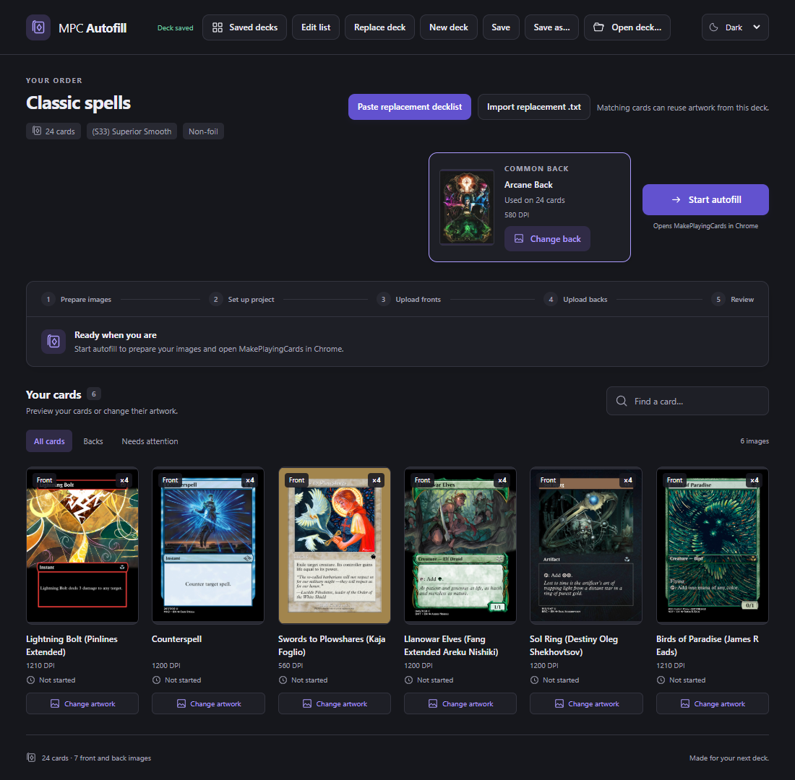
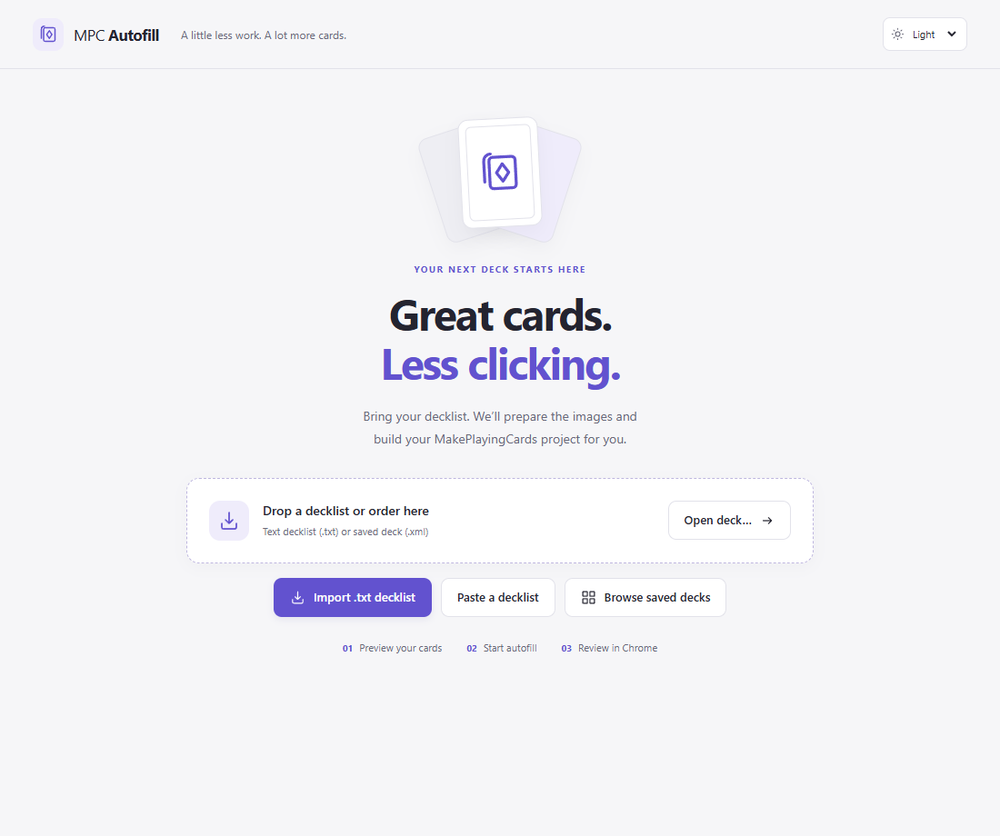
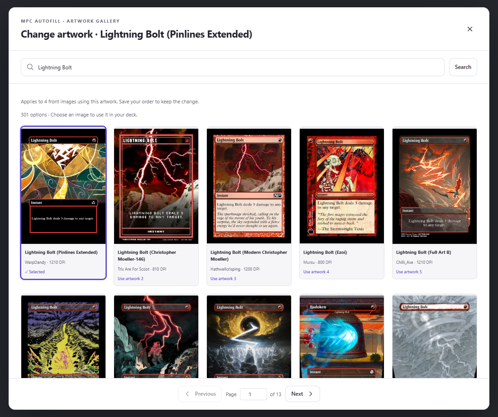

# MPC Autofill (Rust)

An unofficial Rust/Tauri adaptation of
[MPC Autofill](https://github.com/chilli-axe/mpc-autofill), by chilli-axe and
contributors, with a redesigned desktop interface. Maintained separately from
the upstream project; see [attribution and modification notices](NOTICE.md).

A Rust/Tauri desktop app that auto-fills a card order into the MakePlayingCards
project editor. It imports a text decklist or an order XML, downloads the card
images, and drives a visible Chrome via the Chrome DevTools Protocol to build the
project — all from a single window.

## Screenshots

Review your deck, card quantities, print stock, and common card back before
starting autofill. These screenshots show v0.1.4 with a sample deck; the overview
uses the dark theme.



| Import a deck | Choose artwork |
| --- | --- |
| [](docs/screenshots/welcome.png) | [](docs/screenshots/artwork-gallery.png) |
| Paste a decklist or open an existing order XML. | Browse alternate designs and compare their resolution. |

Click either thumbnail to view it at full size.

## Installing a release

Download the package for your computer from
[GitHub Releases](https://github.com/jacobbgreene/mpc-autofill-rs/releases).
The current preview is [v0.1.4](https://github.com/jacobbgreene/mpc-autofill-rs/releases/tag/v0.1.4).
The packaged builds target 64-bit Intel/AMD computers:

- **Windows 10/11:** run the `-setup.exe` installer. It installs WebView2 if
  necessary. The installer is currently unsigned.
- **Linux:** make the `.AppImage` executable and run it, or install the `.deb`
  with your distribution's package manager. The Linux packages are built on
  Ubuntu 22.04; other distributions still need compatibility testing.
- **NixOS:** use the native Nix package described below.

Install Google Chrome or Chromium separately for browser automation. You do not
need Rust, Node, or a development server to run the release packages. Autofill
uses its own browser profile, so your normal browser login is separate.
The repository is private: download links require repository access. When
sharing an installer outside the repository, include the matching source archive,
`LICENSE`, and `NOTICE.md` so its recipient can access the source and license terms.

## Quick start

1. Choose **Import .txt decklist** or **Paste a decklist**. For pasted text, select
   **Choose artwork**, then review the images and choose a common card back.
   Use **Open deck…** for an existing XML deck.
2. Select **Create deck** to save it in **Saved decks**. Incomplete imports are
   saved too; use **Continue import** to finish them before running autofill.
3. Select **Start autofill**, sign in when Chrome prompts you, and review the
   completed project in Chrome. Saving to your MPC account and checkout are manual.

## Choosing the browser

Set `CHROME` to the full path of your preferred browser before starting the app.
For example, on NixOS with Google Chrome installed:

```sh
nix build .#default
CHROME=/run/current-system/sw/bin/google-chrome-stable ./result/bin/mpc-autofill
```

The Nix package defaults to its bundled Chromium when `CHROME` is unset. Windows
and ordinary Linux packages detect an installed browser when it is unset.
Close the app before changing browsers. For development on NixOS, override the
variable **inside** the development environment:

```sh
nix develop --command env CHROME=/run/current-system/sw/bin/google-chrome-stable cargo-tauri dev
```

## Building release packages

The `Release` GitHub Actions workflow checks the frontend and Rust workspace,
builds a Windows NSIS installer plus Linux AppImage and Debian packages, and
checks that the packaged applications start. Windows is tested after a silent
installation; the Linux AppImage is extracted and started on a private display.
These checks do not exercise a signed-in MakePlayingCards upload.

Keep the versions in `Cargo.toml`, `src-tauri/tauri.conf.json`,
`frontend/package.json`, and `flake.nix` in sync, then push a matching tag
(for example, `v0.1.4`). Both platforms must pass before
the workflow creates a draft preview release with installers, a source archive
of the exact build revision, `SOURCE.json`, `LICENSE`, `NOTICE.md`, and SHA-256
checksums. Review the assets and publish the draft to share it. A manual workflow
run on a branch builds downloadable workflow artifacts without creating a release.

To reproduce packaging on a machine with
[Tauri's prerequisites](https://v2.tauri.app/start/prerequisites/) installed,
run these commands in Bash (Git Bash on Windows, so the npm launcher preserves
the `-- --locked` arguments):

```sh
npm --prefix frontend ci
npm install --global @tauri-apps/cli@2.11.4
tauri build --bundles nsis -- --locked          # Windows
tauri build --bundles appimage,deb -- --locked  # Linux
```

When distributing a local build, run `node scripts/collect-source.mjs` from the
same clean, committed checkout. It writes the source archive and license notices
to `dist/`; share them together with the installer. `SOURCE.json` identifies the
commit included in the archive. The script refuses uncommitted tracked changes.

The icon uses the same card symbol as the application header. Regenerate its
platform variants with `tauri icon src-tauri/icons/icon.svg`, or use
`cargo-tauri icon src-tauri/icons/icon.svg` inside the Nix development shell.

## Layout

- `crates/core` — order model + XML parsing, Google Drive download, image
  post-processing. No GUI/browser deps; fast to build and unit-tested.
- `crates/automation` — the CDP driver (`chromiumoxide`) that steps through the
  MakePlayingCards editor.
- `src-tauri` — the Tauri app. A single session actor owns the parsed order,
  downloaded images, and the browser; the UI talks to it over a channel.
- `frontend` — the Svelte + Vite UI.

## Developing on Windows and Linux

Install Rust, Node 22.6+, and
[Tauri's platform prerequisites](https://v2.tauri.app/start/prerequisites/), then
run these commands from the repository root:

```sh
npm --prefix frontend ci
npm install --global @tauri-apps/cli@2.11.4
tauri dev
```

The Tauri CLI starts the Vite development server automatically. Install Chrome
or Chromium as well to exercise autofill.

## Developing on NixOS

The flake provides a NixOS-patched Rust toolchain plus Tauri's native
dependencies and a Chromium for automation.

```sh
# Fast shell for the logic crates (no WebKitGTK):
nix develop .#core --command cargo test -p autofill-core -p autofill-automation --locked

# Full shell for the app (first time: install the frontend deps):
nix develop
npm --prefix frontend ci
cargo-tauri dev
```

Use the **hyphenated** `cargo-tauri dev` command inside the shell to invoke the
flake's Nix-compatible Tauri CLI directly.

`nix develop` exports `CHROME` so the driver launches the flake's Chromium.

CLI-free fallback (if the Tauri CLI ever misbehaves): run the dev server and the
app in two shells — `npm --prefix frontend run dev`, then `cargo run -p mpc-autofill`.

## Scope of this version

- Target: MakePlayingCards, new project only.
- Google Drive images are fetched from the public download endpoint (no service
  account / API key).

Not yet ported from the reference tool: the PrinterStudio sites, append/continue
to an existing project, order combining/splitting, PDF export, and save-to-account.

## Working with an order

Select **Browse saved decks** on the welcome screen to open the deck library.
Search by name or path, sort by name or save date, and click a deck to open it. Use
**Saved decks** in the order toolbar to return; unsaved changes require confirmation.
**Back to start** returns to the original welcome screen.

New orders default to `Documents/MPC Autofill/Decks`, outside the source checkout
and installed application. **Save as…** can choose any other location. Orders
opened or saved elsewhere are remembered by path in `saved-decks.json` in the
platform's app data directory. On first use, existing valid order XML files
directly in Documents are also included without moving or copying them. The
library scans its default folder and refreshes remembered files when opened;
**Refresh** picks up external changes. Missing files are skipped with a notice.
If the platform has no Documents directory, the default deck folder is `decks`
inside the app data directory. Artwork thumbnails remain in the separate cache.

Start with **Import .txt decklist**, **Paste a decklist**, or drop a `.txt` file
onto the welcome screen. Importing a file opens an artwork grid immediately;
for pasted lists, select **Choose artwork**. Each new image starts with the first
MPC Autofill match. Cycle through options using the arrows beside its preview or
enter an artwork number. Click its thumbnail to inspect the current art in a
larger preview. **Browse all artwork** opens a separate gallery that loads more
results as you scroll, with search and the current choice highlighted. Page
controls remain available for direct navigation. The displayed image is
the one used in your deck. Unmatched cards can be searched by another name in
their gallery.

Previews are cached locally, with fallback between MPC Autofill's image CDN and
Google Drive. If a preview cannot load, use **Retry preview** on the card or
**Retry failed previews** in its gallery.

Expand **Print settings** to choose a name, cardstock and finish, and browse the
cardback gallery for a common reverse. **Edit decklist** returns to the text;
artwork choices for matching names are retained when you change quantities.
The suggested deck name is a placeholder that disappears as you type. Leave it
empty to use the imported filename (or **New deck** for a pasted list).
Explicit double-faced pairs keep their own backs. A common back is only required
for cards without an explicit reverse.
In the card-back gallery, use **☆ Favorite** to save a back for future decks.
The most recently favorited back is selected by default when creating a deck;
you can still choose another back before creating it.

The appearance selector in the top bar offers **Light**, **Dark**, and **System**.
Your choice is remembered between sessions; **System** follows your device theme.

**Create deck** saves the import as XML in **Saved decks**, with a numbered
filename when the name is already in use. If the decklist has a syntax error,
artwork is missing, or no common back has been chosen, the XML holds an
unfinished deck with the raw list, print settings, and artwork choices. Open it
and select **Continue import** to fix the issues later. Autofill is unavailable
until the deck is complete. Creating it again after the fixes replaces the same
XML file with a completed order. The imported text file stays unchanged. The
welcome screen opens `.xml` decks and `.txt` lists; older `.mpcdeck` drafts can
still be opened and saved as XML.

Open or drop an order XML to browse its cards. Search by name, show all cards,
backs, or images needing attention, and click a card for a larger preview.
The grid, enlarged preview, and common-back widget show the original artwork's
DPI from MPC Autofill. Existing XML orders load this metadata in the background;
missing values show **DPI unavailable**, and failed lookups offer **Retry DPI**.
Use **Change artwork** below any image (or in its enlarged preview) to choose a
replacement from MPC Autofill. The common-back widget beside **Start autofill**
offers a larger preview and **Change back**, keeping the regular grid focused on
card fronts and individual backs. The card-back gallery loads more options as
you scroll, with a manual load-more button and retry if a request fails.
Common-back failures still appear under
**Needs attention**. A change applies to every copy using that image, preserving
quantities, slot order, and front/back pairings. Save the order to keep the new
artwork.
Autofill shows each stage and asks you to sign in in Chrome when necessary.
If any image cannot be downloaded, autofill stops before opening the project
editor and shows which images need attention.

**Edit list** opens the current order as text. **Replace deck** starts a new list
inside the same order. Both accept pasted text or an imported `.txt` file:

```text
4 Island
1 Lightning Bolt
1 Delver of Secrets // Insectile Aberration
```

Use one card per line with an optional quantity (`4` or `4x`). Blank lines and
lines beginning with `#` or `//` are ignored, along with category headings such
as `COMMANDER (1)`, `CREATURES (20)`, and `Sideboard`. `Front name // Back name` or
`Front name | Back name` specifies a custom reverse. Existing artwork and back
pairings are retained; new names must have artwork chosen from the MPC Autofill
search results before changes can be applied. Use the full artwork name or image
ID to distinguish variants with
the same card name. Each order supports up to 612 cards.
From the deck viewer, use **Paste replacement decklist** or **Import replacement
.txt** to carry matching artwork into the replacement. Adding `// Back name` to
a matching card keeps its front artwork and lets you choose the new reverse.
Use **New deck** for a separate deck, or **Open deck…** for an existing order.

Applying a list updates the loaded order; **Save** writes it back as XML, and
**Save as…** writes a separate XML. Stock, foil, and the common cardback are
preserved. The app warns before discarding unsaved changes. Keyboard shortcuts:
`Ctrl/Cmd+F` searches cards, `Ctrl/Cmd+S` saves, and `Ctrl/Cmd+Shift+S` opens Save As.

## Validation

Run the frontend checks with Node 22.6+ after installing its dependencies:

```sh
npm --prefix frontend run check
npm --prefix frontend test
npm --prefix frontend run build
```

Check release metadata and source packaging with:

```sh
node scripts/check-release-version.mjs
node --test scripts/tests/*.test.mjs
```

Run `cargo test --workspace --locked` with the platform's build prerequisites
installed, or `nix develop --command cargo test --workspace --locked` on NixOS.
The normal tests do not contact MPC Autofill or MakePlayingCards, but Cargo may
need to fetch dependencies on the first run. Node must be on `PATH` for the
automation crate's JavaScript tests.

Optional live artwork search and thumbnail checks are available with:

```sh
nix develop --command cargo test -p mpc-autofill --locked -- --ignored
```

## License and attribution

The application is licensed under the **GNU General Public License version 3
only (`GPL-3.0-only`)**; see [LICENSE](LICENSE). Its order model, image processing,
and browser automation adapt the upstream MPC Autofill desktop tool. Upstream
authors retain their copyright; [NOTICE.md](NOTICE.md) records the source
references, authorship, and dated Rust/Tauri changes.

**About & licenses** in the app provides the license and attribution offline.
Card artwork and other third-party content retain their separate rights.

The attribution and source-packaging changes apply to builds containing the
licensing correction dated 2026-10-16. Previously published installers, including
v0.1.4, retain their original metadata and do not contain the new in-app notices.
